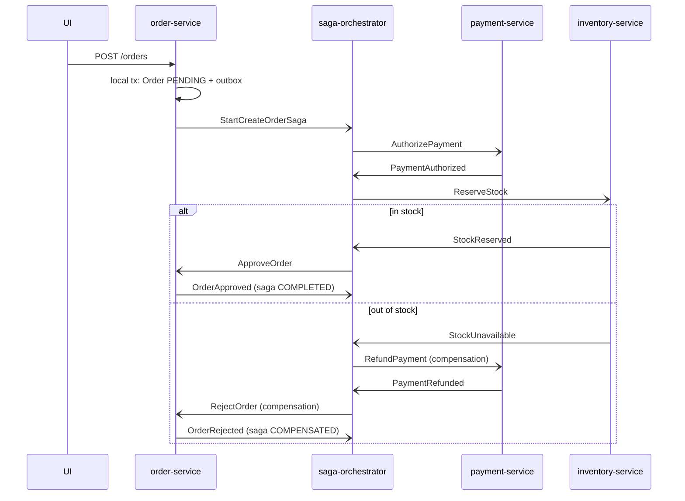
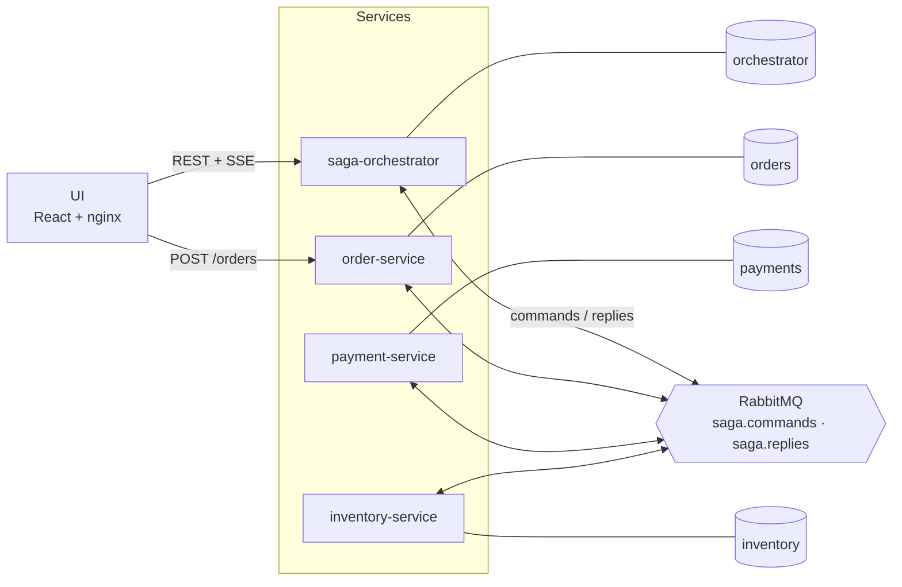

# Saga Pattern: orchestration demo

A hands-on implementation of the [Saga pattern](https://microservices.io/patterns/data/saga.html) with
**Kotlin + Spring Boot + hexagonal architecture + RabbitMQ**, plus a **web UI** that shows how each saga
moves forward, how it compensates when something fails and how it behaves when the infrastructure fails.

## Running it on your machine

### Requirements

- **Docker** with **Docker Compose v2** (Docker Desktop on Mac/Windows, or Docker Engine on Linux).
- About **4 GB of free RAM** for Docker: there are 4 Java services, Postgres and RabbitMQ.
- Ports **3000, 5432, 5672, 8081–8084 and 15672** must be free.

You don't need Java, Gradle or Node installed: everything is built inside Docker.

### Step by step

```bash
git clone https://github.com/PatricioPoncini/saga-orchestration.git
cd saga-orchestration
docker compose up --build -d
```

The first run takes a few minutes because it downloads the images and builds the services. To check
when it's ready:

```bash
docker compose ps
```

When `postgres` and `rabbitmq` show up as `healthy` and the services as `running`, open
**http://localhost:3000** and try the scenarios from the UI.

You can also use `make`: `make up` (start), `make logs` (service logs), `make down` (stop everything).

### What's running

| What | URL |
|---|---|
| Demo UI | http://localhost:3000 |
| RabbitMQ management | http://localhost:15672 (guest / guest) |
| order-service | http://localhost:8081 |
| payment-service | http://localhost:8082 |
| inventory-service | http://localhost:8083 |
| saga-orchestrator | http://localhost:8084 |
| Postgres | `localhost:5432` (saga / saga): databases `orders`, `payments`, `inventory`, `orchestrator` |

### Checking that everything works

```bash
./scripts/smoke-test.sh
```

It runs the scenarios against the running services and shows ✅ or ❌ for each one.

### Stopping everything

```bash
docker compose down      # stops the containers and keeps the data
docker compose down -v   # stops everything and deletes the data
```

### If something doesn't start

- **A port is already in use**: run `lsof -i :3000` (or whichever port it is) to see what's using it, and stop it.
- **A service keeps restarting**: run `docker compose logs -f <service>` to see the error.
- **You changed a SQL migration that was already applied**: run `docker compose down -v` and start again.

### Automatic demo reset

Since this is a demo, every service **empties all its tables** (it doesn't drop them) and purges its RabbitMQ
queues every 15 minutes, aligned to the clock (:00, :15, :30, :45), so all four reset at the same time.
Inventory loads the initial catalog again. The UI shows how long until the next reset.

```bash
DEMO_RESET_INTERVAL=5m docker compose up -d   # every 5 minutes
DEMO_RESET_INTERVAL=0  docker compose up -d   # never
```

You can also set it in a `.env` file next to `docker-compose.yml` (`DEMO_RESET_INTERVAL=1h`).

## The use case: `CreateOrderSaga`

A customer creates an order. To approve it, the system has to **charge the customer** (payment-service) and
**reserve stock** (inventory-service). Each service has **its own database**, so there is no ACID transaction
that covers everything: the saga replaces that distributed transaction with a **sequence of local
transactions**, and every step that can be undone has a **compensating transaction**.

| # | Step | Participant | Type | Compensation |
|---|---|---|---|---|
| 1 | `CREATE_ORDER` (order in `PENDING`) | order-service | compensable | `RejectOrder` |
| 2 | `AUTHORIZE_PAYMENT` | payment-service | compensable | `RefundPayment` |
| 3 | `RESERVE_STOCK` | inventory-service | **pivot** | — |
| 4 | `APPROVE_ORDER` | order-service | retriable | — |



## Guided scenarios (buttons in the UI)

| # | Scenario | Concept it shows | Result |
|---|---|---|---|
| 1 | Happy path | Sequence of local transactions | `COMPLETED` |
| 2 | Payment rejected ($1350 > $1000 limit) | Single-step compensation | `COMPENSATED` |
| 3 | Out of stock (the pivot fails) | Compensations in **reverse order** | `COMPENSATED` |
| 4 | Duplicate messages | Idempotent consumer (Inbox) | `COMPLETED`, with no duplicate effects |
| 5 | Slow payment (14 s vs. a 10 s timeout) | Timeout, retry, business idempotency, late reply discarded | `COMPLETED` |
| 6 | Inventory down | Durable messaging: commands wait in a retry queue (TTL) | `COMPLETED` if it comes back in time, otherwise `FAILED` |

Each scenario sends its faults together with the order (for example `{"faults": {"paymentDelayMs": 14000}}`).
They travel as headers on the messages of **that** saga only, so you can run different scenarios
in parallel (for example, in several tabs) without them affecting each other: "Slow payment" delays only the replies of your saga (outbox with
`available_at`) and "Inventory down" rejects only your messages, which wait in `inventory.retry` and come back on their own.

In the UI you'll see:
- The saga **diagram**: forward steps and compensations (at the bottom, in red, from right to left).
- A **timeline**: who sends what to whom, orchestrator decisions, local transactions and ignored duplicates.
- One saga at a time: you can't start another scenario until the current saga finishes.
- In "Inventory down", a button to bring inventory back up while the saga is waiting.
- The databases of each service and the journey of each message are in the **Data & messages** section (`/data`).

## "Data & messages" section (`/data`)

It shows the databases of each service and how they communicate, without any service reading another one's database:

- **Map**: the 4 databases (business, saga and messaging tables) connected only through RabbitMQ.
- **Journey of each message** in a saga: the sender's `outbox` → exchange → the receiver's `processed_messages`,
  with real timings taken from the tables (relay latency, time in the queue, duplicates).
- **Table explorer**: columns, types and latest rows of each table, filterable by saga.

Each service exposes **read-only** inspection endpoints over its own database (for the demo only):

| Endpoint | Returns |
|---|---|
| `GET /inspect/database` | tables, columns, row counts and pending messages in the outbox |
| `GET /inspect/tables/{table}?limit=25&sagaId=` | latest rows of a table |
| `GET /inspect/outbox?sagaId=` | messages that the service sent in a saga |
| `GET /inspect/inbox?ids=a,b` | which of those messages it has already processed |

## Architecture



- The **UI** creates the order in order-service and follows the saga live from the orchestrator (SSE).
- Services **never call each other**: the orchestrator sends commands through `saga.commands` and each
  participant replies through `saga.replies`.
- Each service has **its own database** (in the same Postgres instance, but without sharing tables) and
  writes its messages to an **outbox** inside the same local transaction.

Each service follows **hexagonal architecture** (ports and adapters):

```
dev/saga/<service>/
  domain/                 ← model and business rules. Plain Kotlin.
  application/port/in/    ← use cases (what the outside world can ask the service to do)
  application/port/out/   ← what the service needs from the outside world (repository, messaging)
  application/service/    ← use case implementations. No Spring.
  adapter/in/             ← web (REST), messaging (RabbitMQ listeners), scheduling
  adapter/out/            ← persistence (JDBC), messaging (Outbox)
  config/                 ← Spring wiring
```

An **ArchUnit** test (`HexagonalArchitectureTest`) in each service breaks the build if `domain` or
`application` depend on Spring or on any adapter.

## Concept → code map

See [docs/concepts.md](docs/concepts.md).

## Development

```bash
./gradlew test                     # domain tests + ArchUnit (JDK 17+)
./scripts/smoke-test.sh            # end-to-end scenarios against docker compose
cd ui && npm install && npm run dev  # UI with hot reload on :3000 (uses the docker services)
```
